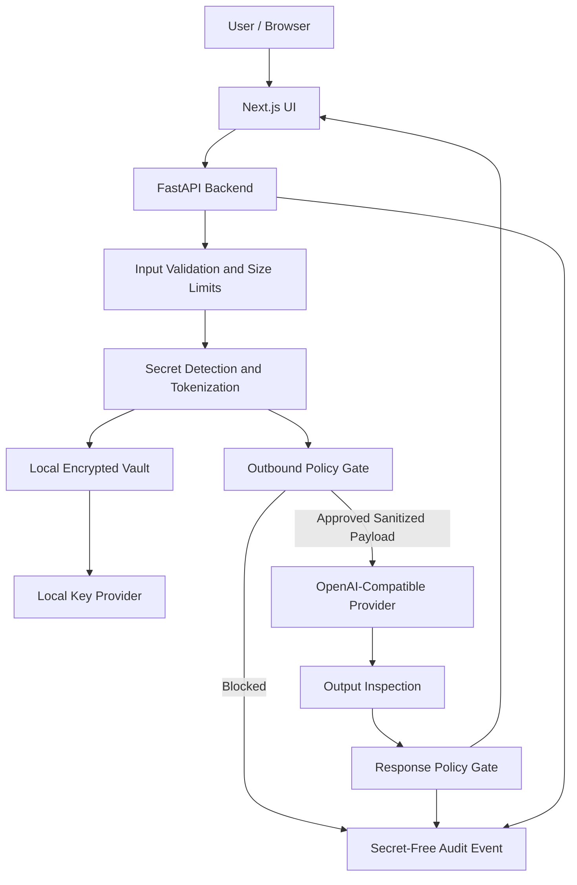

# Architecture — CipherShield AI

Local-first secret-isolating AI gateway for LLM-powered security analysis.

## Request flow

## Components

| Component | Module | Responsibility |
|---|---|---|
| Validation | `app/schemas`, `MAX_INPUT_CHARS` | Size/type bounds, safe error bodies |
| Detection | `app/services/detection` | Pluggable regex detectors; categories: `api_token`, `bearer_token`, `password_kv`, `email`, `ipv4` |
| Tokenization | `app/services/tokenization` | Deterministic `[SECRET_01]`-style placeholders; keeps mapping in memory + vault |
| Vault | `app/services/vault` | AES-256-GCM records; key provider abstraction (env / key file / future KMS) |
| Policy gate | `app/services/policy` | Category allow/deny, tool allowlist, inspects the **exact serialized** outbound body; fails closed |
| Providers | `app/services/providers` | OpenAI-compatible adapter (timeouts, bounded output) and deterministic mock |
| Response inspection | `app/services/response_inspection` | Scans output for known originals + configured patterns; masks/blocks |
| Audit | `app/services/audit` | Secret-free events with optional hash chain |
| Routes | `app/api/routes` | `health`, `config/status`, `analyze/preview`, `analyze`, `audit`, `evaluation/summary`, `vault/restore` |

## Data states across the trust boundary

The merged plan (B1) requires the boundary to distinguish four states:

| State | Where | Form |
|---|---|---|
| 1. Encrypted original input | Vault store | AES-256-GCM ciphertext (the secret→placeholder mapping); never readable without the VEK |
| 2. Trusted local processing | Backend process only | Original input exists as plaintext briefly for detection/sanitization; never logged, never audited |
| 3. Sanitized readable LLM input | The exact serialized request body | Placeholders only — this is what the gate inspects and what may leave the machine |
| 4. External provider boundary | Outside the trust boundary | Receives state 3 over HTTPS in plaintext (not ciphertext — no homomorphic inference claim); never receives VEK, provider-key material in content, or raw mappings |

Per-hop protection details: `security/threat-model.md` §2b. Key roles,
rotation, and invalid-key behavior: `security/key-management.md`.

## Data flow invariants

1. The browser sends raw text only; keys never cross the boundary.
2. Detection happens before any outbound serialization.
3. The policy gate re-scans the **final serialized request body** — not an
   intermediate representation — immediately before send.
4. Only placeholders leave the process boundary.
5. Response inspection runs before output reaches the UI.
6. Restore is a separate, authorized, audited action; default output stays
   sanitized.

## Failure behavior

Fail closed: config invalid, key unavailable, vault decryption failure, or
policy evaluation error ⇒ no provider call, safe error, audited event.

## Deployment

Local demo: `uvicorn` on `127.0.0.1:8000` + Next.js on `:3000`.
Packaging: Docker Compose with health checks; binding stays on localhost
unless remote access is explicitly configured.
